# Dumb PF2e Level-Up Wizard

A level-up assistant and level-1 character builder for PF2e on Foundry VTT, rebuilt for **Foundry VTT v14 (14.364)** and **PF2e 8.x**.

Click the wizard hat on a character sheet, make the choices the new level asks for, check the summary, and the wizard applies everything to the sheet in one step: level, Hit Points, feats, skills, attribute boosts, languages and spells. Characters without a class get a step-by-step builder instead.

It's a fork of [BenABaron/pf2e-level-up-wizard](https://github.com/BenABaron/pf2e-level-up-wizard) (originally by Zumanzo), released under its own module ID (`dumb-pf2e-level-up-wizard`) so it can be installed next to the original. If you enjoy the original module consider [buying its author a coffee](https://buymeacoffee.com/zumanzo)!

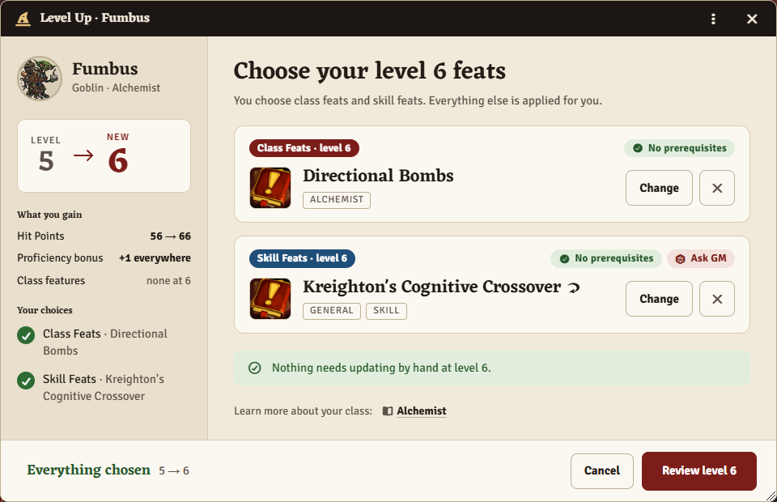

## Installation

In Foundry, go to **Add-on Modules → Install Module** and paste this manifest URL:

```
https://github.com/reactiveoxygenspecies/dumb-pf2e-level-up-wizard/releases/latest/download/module.json
```

The manifest URL works once a GitHub release has been published. To install from source instead, see [Development](#development).

Then enable **Dumb PF2e Level-Up Wizard** in the world's Manage Modules. If you used the original PF2e Level-Up Wizard, read [Coming from the original module](#coming-from-the-original-module) first.

## A quick tour

### The wizard hat

A wizard hat appears next to the character's level on the sheet (or in the window header, depending on the client setting). **Left-click** opens the wizard for the next level, or the character builder if the character has no class yet. **Right-click** opens the level-up history. The hat is dimmed when the character can't level up yet (not enough XP, or level 20).

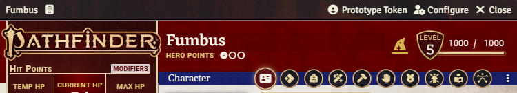

### One page for small level-ups, steps for big ones

A level-up with only a few feats fits on one page (shown at the top of this README). The side panel shows the level change, the Hit Points gained and a checklist of what's left to choose. A level with boosts, skill increases or spells switches to steps automatically. Each skill shows its modifier and the rank it would reach, and the chosen one shows its new modifier.

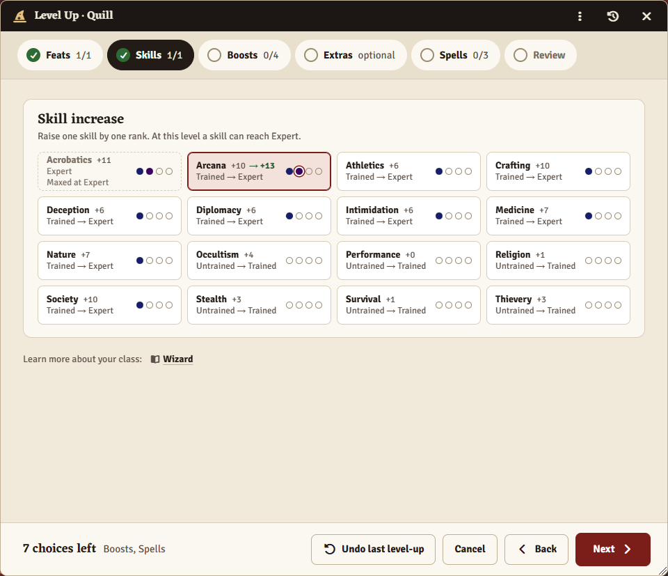

### Feats prerequisites check

The wizard previews the character at the new level and offers exactly the feat slots the character sheet would show, Free Archetype and other variant slots included. Every feat is marked as fitting, not fitting with the reason ("Needs: expert in Athletics"), or "double check" when the prerequisite can't be checked automatically. Choices made in the same level-up count, so a skill increase picked a step earlier can qualify a feat. Uncommon, rare and unique feats get an "Ask GM" pill. You can filter by level, skill, rarity and archetype, read the full description next to the list, and post a feat to chat.

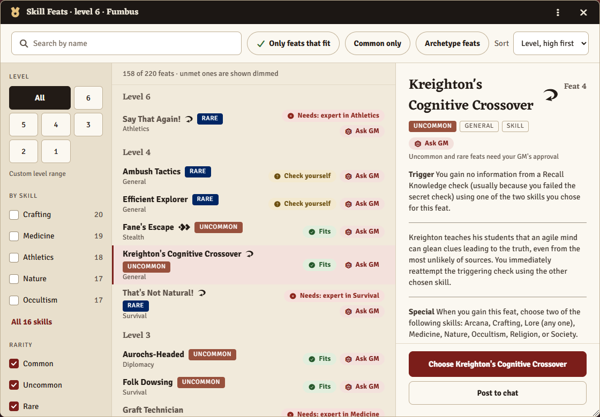

### Spells are kept up to date

For bard, cleric, druid, magus, oracle, psychic, sorcerer, summoner, witch and wizard, the wizard updates the class spellcasting entry's slots at every level and asks for the new repertoire, spellbook or familiar spells. From level 3, spontaneous casters also pick their signature spells here. A spontaneous caster can also swap one repertoire spell for another of the same rank at each level, as the rules allow.

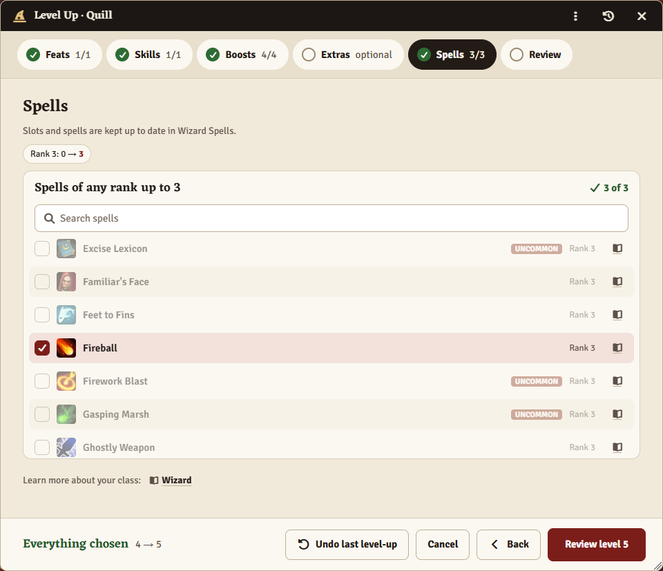

### Review before anything changes

The last step lists every change, what still needs doing by hand, and a preview of the chat message. Nothing touches the character until you press Apply.

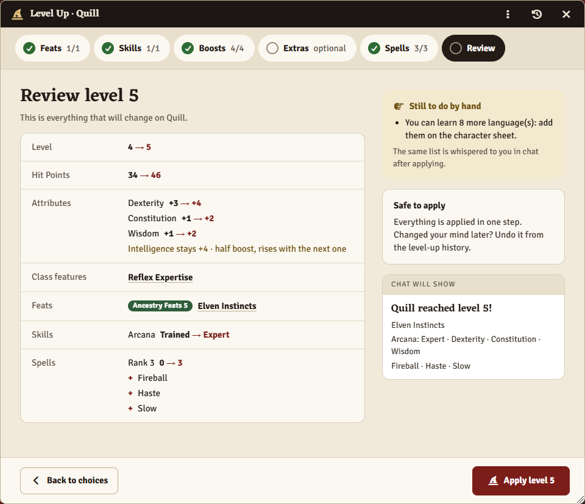

### Chat summary, history and undo

After applying, a chat card lists what was chosen, and a whisper lists anything left to do by hand. Each level-up is recorded, and the most recent one can be undone from the history (right-click the hat).

<p>
  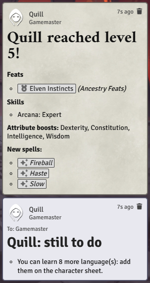
  &nbsp;
  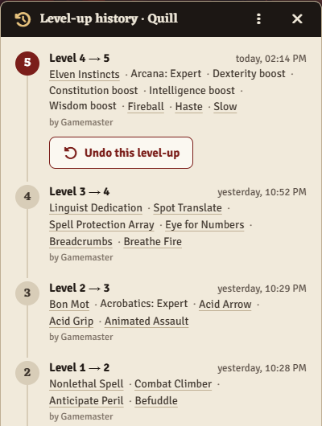
</p>

### Character builder

A character without a class gets a builder instead of the level-up wizard: ancestry, heritage, background, class, the class's level-1 choices, attribute boosts, trained skills, level-1 feats, spells for casters, languages and deity, then a review. The system previews the character after every choice and nothing is saved until "Create character". The build can be undone from the history like a level-up.

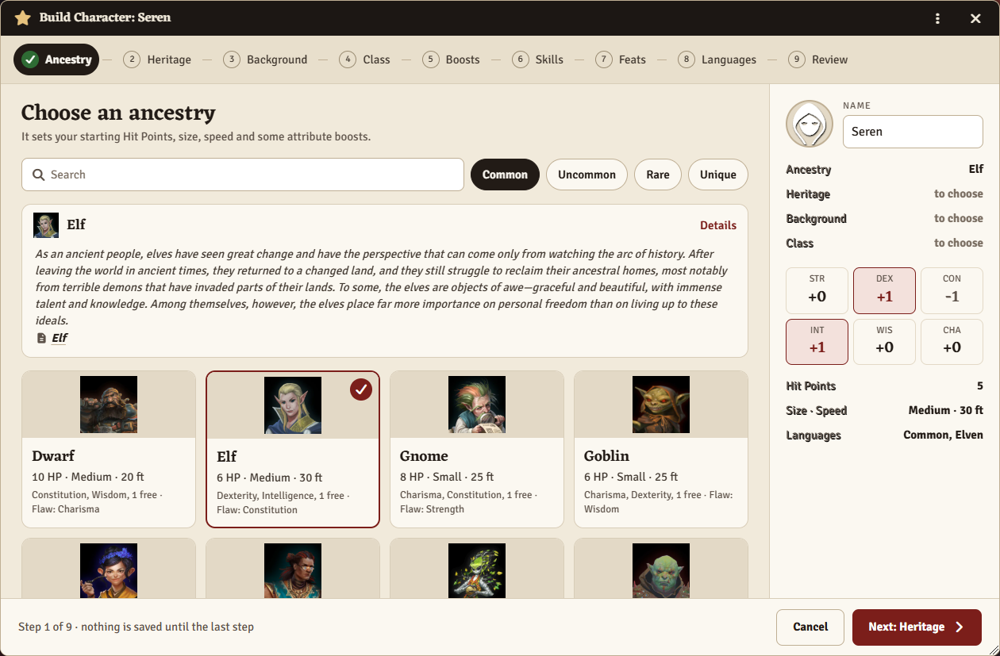

The class's level-1 choices get a step of their own: a sorcerer's bloodline, a cleric's deity, sanctification, doctrine and divine font, a bard's muse, a commander's tactics, a kineticist's gate and impulses, and so on. The options are the ones the system would offer, and the preview follows them, so the skills a bloodline trains are already marked and a bloodline, patron or eidolon sets the spell tradition. The answers are written into the class features, so the system doesn't ask again while the character is created.

Attribute boosts are laid out one row per source, so it's easy to see where each boost comes from and which ones are still free.

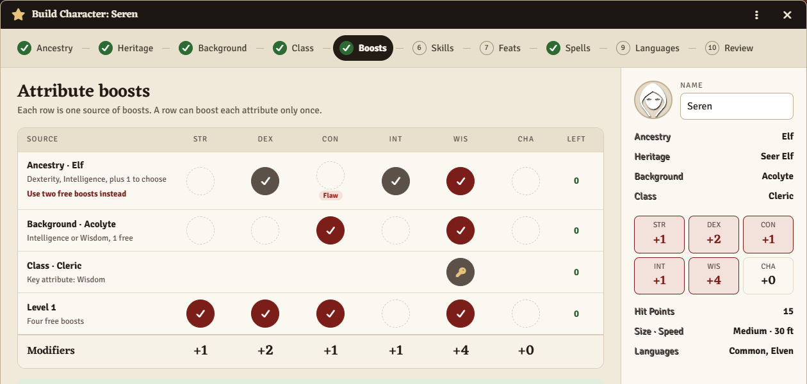

### Focus and innate spells

After a build or level-up, the focus spells that the new feats and class features grant are offered in one dialog: domain spells, bloodline, school, order and mystery spells, compositions and more. The chosen spells go into a focus spellcasting entry of the right tradition, and PF2e raises the focus pool.

Innate spells from feats and heritages (Seer Elf's detect magic, Arcane Sense, Fiendish Magic and many more) are offered in the same dialog, with the sentence they come from, since they are read from the feat's wording. They go into an innate spellcasting entry of their tradition, at the rank the feat names and with its daily uses.

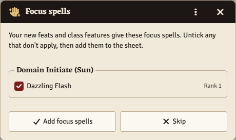

### Alchemist formulas

An alchemist's level-up has a Formulas step for the two common alchemical items the formula book gains each level, up to the new level. Investigators with Alchemical Sciences get one elixir or tool per level the same way. Formulas that a feat or class feature gives once are offered in a dialog after the build or level-up: the alchemist's starting formula book, Alchemical Crafting, the research field's formulas (bombs, healing elixirs, mutagens or poisons), and Alchemist Dedication. Stronger versions of a formula you already know aren't listed, since the base formula covers them. Undo removes the formulas that were added.

## Coming from the original module

- Install this module and **disable the original** in Manage Modules (you can uninstall it later if you prefer this one). With both enabled, characters get two level-up buttons; a GM warning says so.
- Settings are copied from the original the first time this module runs: world settings when a GM logs in, and each player's display preferences in their own browser. "Hide Rare and Uncommon Feats" becomes "Hidden Feat Rarities".
- Level-up history starts fresh; the original didn't keep one.


## What changed compared to the original

- **Character builder (new, #81).** A character without a class gets a builder instead of the level-up wizard: ancestry, heritage, background, class, the class's level-1 choices, attribute boosts, trained skills, level-1 feats, languages and deity, then a review. The character is previewed by the system after every choice, nothing is saved until "Create character", and the build can be undone from the history like a level-up. Class archetypes that take a level-1 class feat slot (War Mage, #85) are offered in the class feat picker. Casters get a Spells step (see below).
- **Class choices in the builder (new).** The choices a class makes at level 1 (bloodline, doctrine, muse, research field, tactics, implement, gate...) and the choices of what they grant (a gate's impulses, a racket's skill) are made in the builder, with the options the system would offer and a description of the selected one. A cleric's or champion's deity is picked here too, since sanctification, cause and divine font depend on it. The preview includes the class features, so skills and spell tradition follow the choices. The answers are written into the features the way the system stores a made choice, so it doesn't prompt for them; choices that only exist once the character does (a feat's own options) are still asked by the system.
- **Class spellcasting (new).** For bard, cleric, druid, magus, oracle, psychic, sorcerer, summoner, witch and wizard, the builder creates the class spellcasting entry with the right slots and the chosen starting spells (repertoire, spellbook or familiar). At each level-up the wizard updates the slots, including wizard curriculum and magus studious slots, and asks for the new repertoire, spellbook or familiar spells. Cleric divine font slots live in a separate Divine Font entry, kept at the highest rank with heal or harm prepared, apart from the regular slots. A caster without an entry can have one set up at any level. Undo restores the slots and removes what was added. Slot tables are generated from PF2e's class journal (`npm run build:spellcasting -- <pf2e checkout>`). Not automated: animist, the witch's patron lesson spell, and swapping out a summoner's lower-rank spells.
- **Signature spells (new).** From level 3, bards, sorcerers, oracles and psychics choose one signature spell per rank in the level-up's Spells step. A summoner's repertoire spells are all marked as signature spells.
- **Repertoire swaps (new).** At each level gained, a spontaneous caster can swap one spell in their repertoire for another spell of the same rank, in the Spells step. The new spell can be a signature spell; undo puts the old one back.
- **Focus spells (new).** After a build or level-up, the focus spells the new feats and class features give are offered in one dialog: domain spells (following the domain chosen in PF2e's prompt), bloodline, school, order and mystery spells, composition spells, and choices such as devotion or qi spells. The chosen spells go into a focus spellcasting entry of the right tradition, PF2e raises the focus pool, and undo removes them. The data is generated from PF2e's feats, class features and domain journal (`npm run build:focus-spells -- <pf2e checkout>`); witch lessons, eidolon spells and a few archetype feats still need adding by hand, and the reminder whisper says so.
- **Innate spells (new).** Innate spells that new feats and heritages give are offered in the same dialog as focus spells: the linked spells, the spell picked in a feat's own prompt (Fiendish Magic), or a cantrip picked from a tradition's list (First World Magic). Each goes into an innate entry of its tradition, at the rank the feat names (or heightened to half the level) and with its daily uses. Since the grants are read from the feats' wording (`npm run build:innate-spells -- <pf2e checkout>`), the dialog shows the sentence each one comes from to check. Feats that mention innate spells in a way the script can't read stay in the reminder whisper.
- **Alchemist formulas (new).** The level-up wizard asks for the alchemist's two new formulas each level (and the investigator's one with Alchemical Sciences) in a Formulas step. Formulas from the starting formula book, Alchemical Crafting, the research field and Alchemist Dedication are offered in a dialog after the build or level-up, limited to the kind the field allows. Known formulas and their stronger versions are left out, and undo removes what was added.
- **New look.** Every window uses a light "parchment" design that matches the PF2e sheet (Eczar headings from PF2e, Signika body text from Foundry; nothing is downloaded), regardless of Foundry's light or dark theme. The character sheet itself is not restyled.
- **Single page or steps.** Small level-ups (a few feats) fit on one page with a side panel showing the level change, HP and a checklist. Bigger ones (boosts, many skills) switch to steps automatically.
- **Review before applying.** A final step lists every change (level, HP, attributes, feats, skills, languages, spells, XP), what's left to do by hand, and a preview of the chat message, instead of a yes/no dialog.
- **Feat slots come from the system.** The wizard previews the character at the new level (an in-memory copy the system prepares like the real actor) and offers exactly the empty slots the character sheet would show, using the same filters as the sheet's "browse" button. Free Archetype, mythic (including variant tiers), dual-class and other module-added feat sections, versatile heritages and Adopted Ancestry (#84) all work without hard-coded level lists. Class traits come from the class slug, so translated class names work (#89).
- **Archetype feats from other classes.** Feats an archetype unlocks from another class (Avenger's Twin Takedown, for example) are offered once the character has that dedication, at the level the archetype grants them. The data is generated from PF2e's archetype journal (`npm run build:archetype-feats -- <pf2e checkout>`) and validated against the feat compendium.
- **Prerequisite checking (#93, #87, #95).** Every feat is marked as met, not met, or can't be checked. Same-level choices count, so a skill increase or boost picked in the wizard can qualify a feat. Players can hide feats with unmet prerequisites. Nothing is ever blocked.
- **Applied as one change, with undo (#91).** All actor changes go out in one update; if adding the feats fails, everything is rolled back. Each level-up is recorded, and the most recent one can be undone from the wizard, the history window (right-click the hat), or the API.
- **Intelligence increases (#32).** When a boost raises the Intelligence modifier, the wizard asks for the extra trained skill and offers the extra language.
- **Feats that train a skill you already have.** A feat that makes you trained in a skill (Bouncy Goblin, the lore feats, many dedications) gives another skill of your choice when you're already trained in it. The builder and the wizard spot this, counting the background, class, this level's skill increases and the other picked feats, and ask for the other skill right under the feat. It's applied with the rest and undone with it.
- **Languages.** Unassigned language slots can be filled in the wizard, respecting the campaign's language rarities.
- **Lore skills** can be increased (they were written to the wrong place before).
- **Attribute boosts** use the system's own allowed-boost counts and partial-boost rule, and skip characters with manually entered attributes.
- **Optional choices (#90).** "Require All Choices" can be turned off so players can leave slots empty for later.
- **Rarity setting split (#94).** Hide nothing, rare and unique, or uncommon and above.
- **Lock Level Field** now works with "Enforce XP Requirements" (#82).
- **Missed slots.** Empty feat slots from earlier levels are offered as optional picks. If a level was raised by several steps at once (automatic mode), every level in between is handled.
- **Reminders.** A whisper lists what still needs manual work: spell slots for spellcasting entries the module doesn't manage (archetype casting, #92), new spell ranks, feats that mention focus spells or cantrips (#66), open languages and empty slots.
- **Faster feat loading.** Compendium indexes are used instead of loading every feat document, and the packs follow the system's Compendium Browser settings (homebrew compendiums included automatically).
- **Better feat picker.** Search (including Babele original names), "only feats that fit", rarity, archetype and dedication filters, skill filter with counts, feats grouped by level with the reason a prerequisite isn't met ("Needs expert Medicine"), a description pane, double-click to choose, and "post to chat" with the system's own chat card.
- **v14 ready.** ApplicationV2 with Handlebars parts throughout, no jQuery in the module's own windows, namespaced Foundry APIs, and the feat picker follows the wizard into v14 pop-out windows.
- **SF2e** is recognized (#88) through the shared system API. This is untested.

## Usage

See [the wizard hat](#the-wizard-hat) above for the button. If the GM disables the button, the wizard opens automatically after a character's level is raised manually. Characters without a class still get the hat, for the builder.

### Macro API

```js
const api = game.modules.get('dumb-pf2e-level-up-wizard').api;
api.open(actor);            // open the wizard (or the builder for a character without a class)
api.build(actor);           // open the character builder
api.history(actor);         // show the history window
api.getHistory(actor);      // recorded level-ups
api.undoLastLevelUp(actor); // undo the most recent one (asks for confirmation)
```

## Settings

| Setting | Scope | Notes |
| --- | --- | --- |
| Enable Level-Up Button | World | Off = open the wizard automatically after a manual level change. |
| Level-Up Button Placement | Client | Next to level (small/large) or window header. |
| Lock Level Field | World | Disables the sheet's level input. |
| Enforce XP Requirements | World | Level-ups need enough XP; the XP is deducted. |
| Require All Choices | World | Off = players can leave choices empty. |
| Allow Players to Undo Level-Ups | World | The GM can always undo. |
| Prerequisite Checking | World | Mark prerequisites, or off. |
| Hide Feats with Unmet Prerequisites | Client | Default for the feat picker filter. |
| Hidden Feat Rarities | World | Replaces "Hide Rare and Uncommon Feats" (migrated automatically). |
| Feat Sorting | Client | Default sort in the feat picker. |
| Skill Increase Info | Client | How much detail skill selections show. |
| Send Reminder Whispers to GM | World | Copy the manual-update reminders to the GM. |
| Additional Feat Compendiums | World | Extra compendiums beyond the Compendium Browser's selection. |

## Development

```bash
npm install
npm run lint
npm test
npm run build   # copies the files Foundry needs into dist/dumb-pf2e-level-up-wizard/
```

To install on a server, upload `dist/dumb-pf2e-level-up-wizard/` into the server's `Data/modules/` folder (replace the folder if it's already there), restart Foundry and enable the module in the world.

`npm test` runs the unit tests (prerequisite parser, slot matching and boost math against real PF2e data) and checks the localization files: every key the code uses must exist in English, and translations may not keep keys English no longer has or use placeholders English doesn't. Lint and tests run on GitHub for every push to `main` and every pull request. The data tests read a PF2e source checkout; pass its path with `PF2E_SOURCE=/path/to/pf2e`. `tests/prereq-coverage.mjs <pf2e-path>` reports how many real prerequisite lines the parser understands.

The screenshots in `screenshots/` were taken on Foundry 14.364 with PF2e 8.2.0.

## Credits

Based on the PF2e Level-Up Wizard: original module by Zumanzo, maintained by BenABaron and contributors, with translations by the community. Licensed under the terms in [LICENSE](LICENSE).
